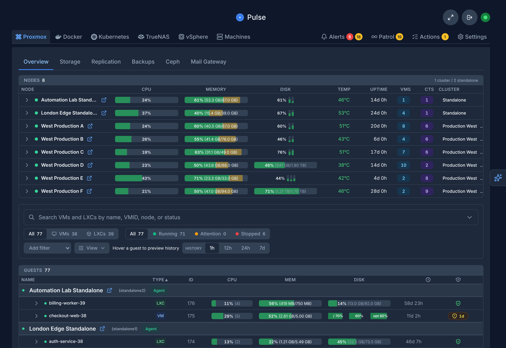

# Pulse

<div align="center">
  
  <p><strong>Real-time Proxmox, Docker and Kubernetes monitoring that finds what needs attention.</strong></p>

  [](https://github.com/rcourtman/Pulse)
  [](https://github.com/rcourtman/Pulse/releases/latest)
  [](https://hub.docker.com/r/rcourtman/pulse)
  [](LICENSE)

  [Live demo](https://demo.pulserelay.pro) · [Documentation](docs/README.md) · [Releases](https://github.com/rcourtman/Pulse/releases) · [Discussions](https://github.com/rcourtman/Pulse/discussions)
</div>

Pulse is a self-hosted dashboard and alerting tool for your homelab or
infrastructure. Point it at Proxmox, Docker, Kubernetes, TrueNAS, vSphere or
your own Linux, Windows and macOS machines, and it shows their health in one
place, keeps the history, and tells you when something needs attention: a
failed backup, a filling disk, an unhealthy container, a node that dropped
offline.



Want to look around first? The [live demo](https://demo.pulserelay.pro) runs on
sample data and signs you in automatically.

## What Pulse does

- **Gives each platform its own page.** Proxmox, Docker, Kubernetes, TrueNAS,
  vSphere and machines each get a view that matches how you already think
  about them, with storage and backups beside the systems they belong to.
- **Alerts you when it matters.** Set thresholds for CPU, memory, disk,
  temperature and more, and get notified by email or through Discord, Slack,
  Teams, Telegram, ntfy, Gotify, Pushover, PagerDuty or any webhook.
- **Checks the things that can't run an agent.** Ping, TCP, UDP and HTTP(S)
  availability checks cover routers, printers and web services, with
  certificate-expiry warnings.
- **Keeps history.** Every guest, container and host has charts: seven days in
  Community, ninety in Pro.
- **Optional AI checks.** Connect your own AI provider or a local model and
  Pulse Patrol runs scheduled checks for problems a dashboard only shows if
  someone is looking. An MCP adapter lets clients such as Claude Code and
  OpenCode query Pulse.
- **Stays hands-off by default.** Proxmox is read through a read-only API
  token, credentials are encrypted at rest, and agent commands stay off unless
  you turn them on.

## Supported platforms

| Platform | What Pulse shows |
|---|---|
| Proxmox VE, PBS and PMG | Nodes, VMs and containers, storage, backups, replication, Ceph and mail gateways |
| Docker and Podman | Hosts, containers, Compose projects, Swarm services, health, images and updates |
| Kubernetes | Clusters, nodes, workloads, pods, services, storage and events |
| TrueNAS SCALE and CORE | Pools, datasets, disks, snapshots, replication tasks, apps and VMs |
| Linux, Windows and macOS | Host health, filesystems, networking, temperatures, RAID and availability |
| VMware vSphere (early access) | Hosts, clusters, VMs, datastores, networks and snapshots; validate against your own vCenter before relying on it |

## Install

Pulse is one container or service listening on port 7655. Pick an exact
version from the [latest release](https://github.com/rcourtman/Pulse/releases/latest)
and use it in place of `vX.Y.Z` below.

### Docker

```bash
docker run -d \
  --name pulse \
  -p 127.0.0.1:7655:7655 \
  -v pulse_data:/data \
  -e PULSE_DEPLOYMENT_METHOD=docker_run \
  --restart unless-stopped \
  rcourtman/pulse:vX.Y.Z
```

This new-install example binds the published port to the Docker host's IPv4
loopback, not every host interface. Before entering any bootstrap token or
password, use [protected first-time setup](docs/INSTALL.md#open-a-protected-setup-connection):
verified HTTPS, a browser on that host, or an SSH tunnel from your workstation.
Do not send setup credentials to a remote plain-HTTP address. Docker host
monitoring is provided by the unified agent; the Pulse server container does
not need the Docker socket.

### Proxmox LXC or Linux

- [Signed Proxmox LXC and Linux installation](docs/INSTALL.md#quick-start-recommended)
- [Docker Compose](docs/INSTALL.md#docker-compose)
- [Kubernetes and Helm](docs/KUBERNETES.md)

Use the complete [signed LXC recipe](docs/INSTALL.md#proxmox-ve-lxc-installer)
on the Proxmox host, or the [systemd recipe](docs/INSTALL.md#2-bare-metal--systemd)
on a standard Linux host. These Bash recipes use private temporary files,
ignore local curl settings, allow only HTTPS redirects and require HTTP 200
within 60 seconds for each file before verifying the pinned `pulse-installer`
signature. Keep the whole recipe intact; do not run its final command separately
to bypass a failed download or signature check.

Also available: [Docker Compose](docs/INSTALL.md#docker-compose),
[Kubernetes with Helm](docs/KUBERNETES.md) and the [full install guide](docs/INSTALL.md).

### First run

Open Pulse through the [protected setup connection](docs/INSTALL.md#open-a-protected-setup-connection)
(verified HTTPS, a browser on the Docker host, or an SSH tunnel), then paste
the one-time setup token. Get it with
`docker exec pulse /app/pulse bootstrap-token` on Docker, or
`sudo pulse bootstrap-token` on Linux (the LXC installer prints the exact
command). Create your admin account, then add your first system with
**Add infrastructure** under **Settings → Infrastructure**.

### Do you need an agent?

Often not. Proxmox VE, PBS and PMG are monitored through their API with a
read-only token, so no Pulse host agent is required; the generated setup script
creates a privilege-separated monitoring user. Install the unified agent where
an API can't give Pulse what you want: Docker and Podman hosts, Kubernetes,
standalone machines, or host SMART health and temperatures.

Agents, including v5-to-v6 agent upgrades, are installed with the per-host
command under **Settings → Infrastructure → Install on a host**. The GitHub
installer above is for the Pulse server only. Command execution is off by
default, the agent's local listener binds to localhost, and on Linux
`--least-privilege` runs it as a dedicated non-root user. The
[agent security model](docs/AGENT_SECURITY.md) lists what it can and cannot do
at each privilege level.

> [!WARNING]
> **API-only does not mean guest-agent-free.** VM filesystem and memory
> requests through QEMU Guest Agent can share the channel used by
> freeze-enabled backups. Read-only permissions do not prove backup
> safety. Do not add permissions, enable or restart an agent, or send manual
> guest-agent probes during a backup, freeze or thaw. An OK backup task does
> not prove successful thaw. Stopping Pulse also stops its monitoring and
> alerts. Read the [backup safety precaution](docs/VM_DISK_MONITORING.md#backup-safety)
> before you need it.

## Editions

- **Community** (free, this repository): self-hosted monitoring, seven days
  of metric history, core SSO, update alerts, and Patrol with your own AI
  provider or a local model.
- **Pro**: Community plus Patrol investigation and fixes, ninety days
  of history, centralized agent profiles, RBAC, audit logging and reporting.
- **MSP**: one Pulse Account running isolated workspaces for each client, with
  separate dashboards, alerts, users, audit history and reports. Try it free
  for sixty days with two clients at [Pulse for MSPs](https://pulserelay.pro/msp).

Core self-hosted monitoring is not gated by how many systems or child
resources you monitor. See the [capability reference](docs/PULSE_PRO.md) and
[current plans](https://pulserelay.pro).

> [!IMPORTANT]
> GitHub release assets and `rcourtman/pulse` images are Community builds.
> Pro, Relay and eligible legacy customers should install the private image or
> Linux archive from the [Pulse download portal](https://pulserelay.pro/download.html).
> Replacing a private Pro runtime with a Community build removes its private
> runtime hooks.

Relay is no longer sold. Existing subscribers keep Pro features at their
current price for as long as their subscription continues, and paired phones
keep working until **31 March 2027**. Relay connects the app, not the web UI:
use your own VPN or tunnel for remote access, and add an ntfy, Gotify or
Pushover destination for phone alerts.

## Documentation

- [Install](docs/INSTALL.md) · [Production security](docs/PRODUCTION_SECURITY.md) · [Upgrading from v5](docs/UPGRADE_v6.md) · [Configuration](docs/CONFIGURATION.md)
- [Platform and agent guides](docs/README.md#platforms-and-agents) · [Pulse Intelligence](docs/AI.md) · [Releases and update channels](docs/RELEASE_PROCESS.md)
- [Troubleshooting](docs/TROUBLESHOOTING.md) · [API](docs/API.md) · [Architecture](ARCHITECTURE.md) · [Security](SECURITY.md) · [Privacy](docs/PRIVACY.md) · [Code signing](docs/CODE_SIGNING_POLICY.md)

Getting started in other languages:
[Deutsch](docs/i18n/de/README.md) · [Español](docs/i18n/es/README.md)

## Community and support

- Questions and ideas: [GitHub Discussions](https://github.com/rcourtman/Pulse/discussions)
- Bugs and unexpected behaviour: [GitHub Issues](https://github.com/rcourtman/Pulse/issues)
- Home Assistant: community-maintained [Pulse add-ons](https://github.com/Kosztyk/homeassistant-addons)
- Support development: [GitHub Sponsors](https://github.com/sponsors/rcourtman) or [Ko-fi](https://ko-fi.com/rcourtman)

Before filing a bug, read the
[safe reporting guidance](docs/TROUBLESHOOTING.md#-getting-help). Your original
evidence is enough. A second reproduction or diagnostics export is not
required, so please don't repeat anything that could interrupt workloads or
send duplicate notifications. GitHub reports and attachments are public:
review them locally and keep credentials and private details out.

## Development

Pulse uses Go 1.26 and a SolidJS/TypeScript frontend. For local reproduction,
follow the [isolated development workflow](CONTRIBUTING.md#hot-reload-dev-loop)
for dependency setup, separate data, loopback-only access and starting without
listener takeover. Use a disposable VM or machine with no production configuration,
data or access to monitored systems; do not start development in an installed
Pulse directory. A fresh clone alone is not isolation.

The `npm run dev` shortcut includes `--takeover` and can stop existing listeners.
The linked workflow instead refuses occupied ports and explains how to choose
unused ones. It also covers local environment files and the development
authentication bypass; keep that bypass off untrusted networks. Use the browser
entrypoint reported by the owned development runtime, not a production Pulse URL.

Read [CONTRIBUTING.md](CONTRIBUTING.md) before starting on a change: Pulse
works issue-first and does not normally accept unsolicited pull requests.

## License

Everything in this repository is [MIT licensed](LICENSE), with no dual
licensing and no source-available code. Pulse Pro is a separate commercial
product built from private sources, sold through [pulserelay.pro](https://pulserelay.pro)
under [Terms of Service](TERMS.md) that apply to that product only.
