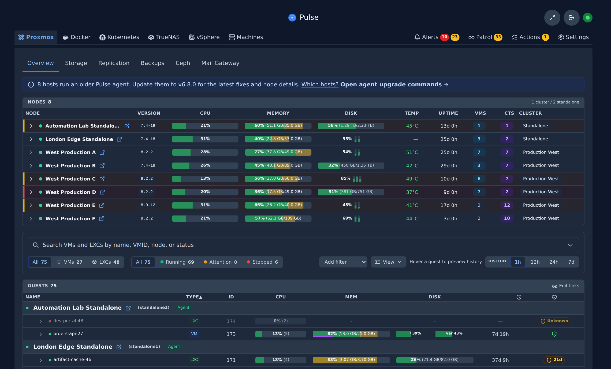

# Pulse

<div align="center">
  
  <p><strong>Real-time Proxmox, Docker and Kubernetes monitoring that finds what needs attention.</strong></p>

  [](https://github.com/rcourtman/Pulse)
  [](https://github.com/rcourtman/Pulse/releases/latest)
  [](https://hub.docker.com/r/rcourtman/pulse)
  [](LICENSE)

  [Live demo](https://demo.pulserelay.pro) · [Documentation](docs/README.md) · [Releases](https://github.com/rcourtman/Pulse/releases) · [Discussions](https://github.com/rcourtman/Pulse/discussions)
</div>

Pulse is a self-hosted dashboard and alerting tool for your homelab or
infrastructure. Point it at Proxmox, Docker, Kubernetes, TrueNAS, vSphere or
your own Linux, Windows and macOS machines to see their health in one place,
keep the history, and get alerted when something breaks: a failed backup, a
filling disk, an unhealthy container, or a node that drops offline.



Try the [Proxmox overview](https://demo.pulserelay.pro) or
[Docker hosts and containers](https://demo.pulserelay.pro/docker/overview) in
the live demo — no sign-up required, running on sample data.

## What Pulse does

- **Gives each platform its own view.** Proxmox, Docker, Kubernetes, TrueNAS,
  vSphere and standalone hosts each get a layout built around how you already
  operate them, with storage and backups next to the systems they belong to.
- **Alerts you when it matters.** Set thresholds for CPU, memory, disk,
  temperature and more, delivered by email, Discord, Slack, Teams, Telegram,
  ntfy, Gotify, Pushover, PagerDuty or webhooks.
  [Alerting guide](docs/ALERTING.md).
- **Monitors what can't run an agent.** Ping, TCP, UDP and HTTP(S) checks cover
  routers, printers and web services, including TLS certificate-expiry warnings.
  [Availability checks](docs/AVAILABILITY.md).
- **Keeps metric history.** Charts and history for every guest, container and
  host without external time-series infrastructure.
- **Optional AI checks.** Connect your own AI provider or local model so Pulse
  Patrol can flag issues on a schedule without someone staring at a dashboard.
- **Answers your own AI agent.** Connect Claude Code, Codex or OpenCode via
  [`pulse-mcp`](cmd/pulse-mcp/README.md#quick-start) with a read-only token and
  [ask what changed overnight](docs/WHAT_HAPPENED_OVERNIGHT.md).
- **Hands-off by default.** Proxmox uses a read-only API token, credentials are
  encrypted at rest, and remote agent commands stay off unless you enable them.

## Supported platforms

| Platform | What Pulse shows |
|---|---|
| Proxmox VE, PBS and PMG | Nodes, VMs and containers, storage, backups, replication, Ceph and mail gateways |
| Docker and Podman | Hosts, containers, Compose projects, Swarm services, health, images and updates |
| Kubernetes | Clusters, nodes, workloads, pods, services, storage and events |
| TrueNAS SCALE and CORE | Pools, datasets, disks, snapshots, replication tasks, apps and VMs |
| Linux, Windows and macOS | Host health, filesystems, networking, temperatures, RAID and availability |
| VMware vSphere (early access) | Hosts, clusters, VMs, datastores, networks and snapshots; validate against your own vCenter before relying on it |

## Install

Pulse runs as a single container or Linux service on port `7655`. Commands
below target the current stable release; swap the tag if a
[newer release](https://github.com/rcourtman/Pulse/releases/latest) is out.

### Docker

```bash
docker run -d \
  --name pulse \
  -p 7655:7655 \
  -v pulse_data:/data \
  -e PULSE_DEPLOYMENT_METHOD=docker_run \
  --restart unless-stopped \
  rcourtman/pulse:v6.8.0
```

<details>
<summary>Docker Compose</summary>

```yaml
services:
  pulse:
    image: rcourtman/pulse:v6.8.0
    container_name: pulse
    ports:
      - "7655:7655"
    volumes:
      - pulse_data:/data
    environment:
      - PULSE_DEPLOYMENT_METHOD=docker_compose
    restart: unless-stopped
volumes:
  pulse_data:
```

</details>

The Pulse container does not need the Docker socket; Docker hosts report via the
agent below.

### Proxmox LXC or Linux

The server installer is signed. Paste the full block to download, verify against
the pinned `pulse-installer` key, and run it only if verification succeeds:

```bash
export PULSE_VERSION=v6.8.0
curl -fsSLO "https://github.com/rcourtman/Pulse/releases/download/${PULSE_VERSION}/install.sh" &&
curl -fsSLO "https://github.com/rcourtman/Pulse/releases/download/${PULSE_VERSION}/install.sh.sshsig" &&
ssh-keygen -Y verify \
  -f <(printf '%s\n' 'pulse-installer namespaces="pulse-install" ssh-ed25519 AAAAC3NzaC1lZDI1NTE5AAAAIMZd/DaH+BldzOkq1A8KVTcFk73nAyrE8aJOyf7i00jm pulse-installer') \
  -I pulse-installer \
  -n pulse-install \
  -s install.sh.sshsig < install.sh &&
bash install.sh --version "${PULSE_VERSION}"
```

Also available: [Kubernetes with Helm](docs/KUBERNETES.md) and the
[full install guide](docs/INSTALL.md).

### First run

Open `http://<your-ip>:7655` and paste the one-time setup token from
`docker exec pulse /app/pulse bootstrap-token` (Docker) or
`sudo pulse bootstrap-token` (Linux). Create your admin account, then add your
first system under **Settings → Infrastructure → Add infrastructure**.

### Do you need an agent?

Often not. Proxmox VE, PBS and PMG connect over their API with a read-only
token, so no Pulse host agent is required. Install the unified agent where an
API cannot reach what you need: Docker and Podman hosts, Kubernetes, standalone
machines, or host SMART health and temperatures.

Agents — including v5-to-v6 agent upgrades — are installed with the per-host
command under **Settings → Infrastructure → Install on a host**. Command
execution is off by default, the local listener binds to localhost, and Linux
supports `--least-privilege`. See the [agent security model](docs/AGENT_SECURITY.md).

> [!NOTE]
> Even without a Pulse host agent, Proxmox VM disk and memory queries use QEMU
> Guest Agent, which shares the channel used by freeze-enabled backups. Read the
> [backup safety precaution](docs/VM_DISK_MONITORING.md#backup-safety) before
> changing guest-agent settings or probing VMs during backups.

## Editions

- **Community** (free, this repository): self-hosted monitoring, core SSO,
  update alerts, and Patrol with your own AI provider or local model.
- **Pro**: Community plus Patrol investigation and fixes, centralized agent
  profiles, RBAC, audit logging and reporting.
- **MSP**: isolated per-client workspaces under one Pulse Account, with a
  60-day free trial for two clients at [Pulse for MSPs](https://pulserelay.pro/msp).

Core self-hosted monitoring is not gated by how many systems or child resources
you monitor. See the [capability reference](docs/PULSE_PRO.md) and
[current plans](https://pulserelay.pro).

> [!IMPORTANT]
> GitHub releases and `rcourtman/pulse` are Community builds. Pro and eligible
> legacy customers should install from the
> [Pulse download portal](https://pulserelay.pro/download.html).
> Relay is no longer sold — existing subscribers keep Pro features at their
> current price, and paired phones keep working until **31 March 2027**
> ([details](docs/PULSE_PRO.md)).

## Documentation

- [Install](docs/INSTALL.md) · [Production security](docs/PRODUCTION_SECURITY.md) · [Upgrading from v5](docs/UPGRADE_v6.md) · [Configuration](docs/CONFIGURATION.md)
- [Platform and agent guides](docs/README.md#platforms-and-agents) · [Pulse Intelligence](docs/AI.md) · [Releases and update channels](docs/RELEASE_PROCESS.md)
- [Troubleshooting](docs/TROUBLESHOOTING.md) · [API](docs/API.md) · [Architecture](ARCHITECTURE.md) · [Security](SECURITY.md) · [Privacy](docs/PRIVACY.md) · [Code signing](docs/CODE_SIGNING_POLICY.md)

Other languages: [Deutsch](docs/i18n/de/README.md) · [Español](docs/i18n/es/README.md) · [Français](docs/i18n/fr/README.md)

## Community and support

- Questions and ideas: [GitHub Discussions](https://github.com/rcourtman/Pulse/discussions)
- Bugs: [GitHub Issues](https://github.com/rcourtman/Pulse/issues) — read the [safe reporting guidance](docs/TROUBLESHOOTING.md#-getting-help) first and keep credentials out of public attachments.
- Home Assistant: community-maintained [Pulse add-ons](https://github.com/Kosztyk/homeassistant-addons)
- Support development: [GitHub Sponsors](https://github.com/sponsors/rcourtman) or [Ko-fi](https://ko-fi.com/rcourtman)

## Development

Pulse is Go 1.26 with a SolidJS and TypeScript frontend. The managed dev
runtime serves the frontend at `http://127.0.0.1:5173` and proxies API and
WebSocket traffic to port `7655`:

```bash
npm ci
npm --prefix frontend-modern ci
npm run dev
```

Read [CONTRIBUTING.md](CONTRIBUTING.md) before starting on a change: Pulse
works issue-first and does not normally accept unsolicited pull requests.

## License

Everything in this repository is [MIT licensed](LICENSE) — no dual licensing
and no source-available code. Pulse Pro is a separate commercial product built
from private sources and sold through [pulserelay.pro](https://pulserelay.pro)
under its own [Terms of Service](TERMS.md).
