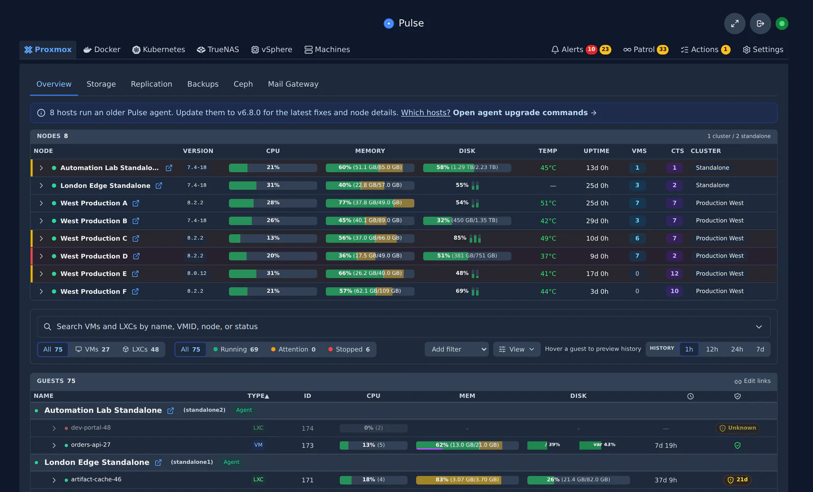
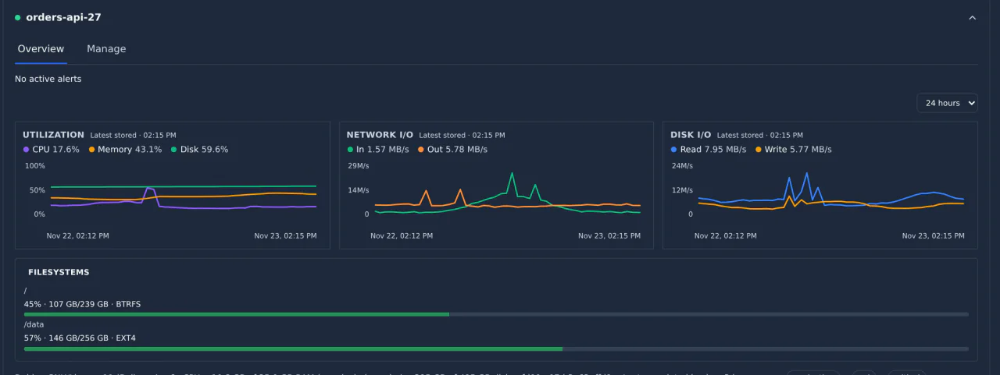
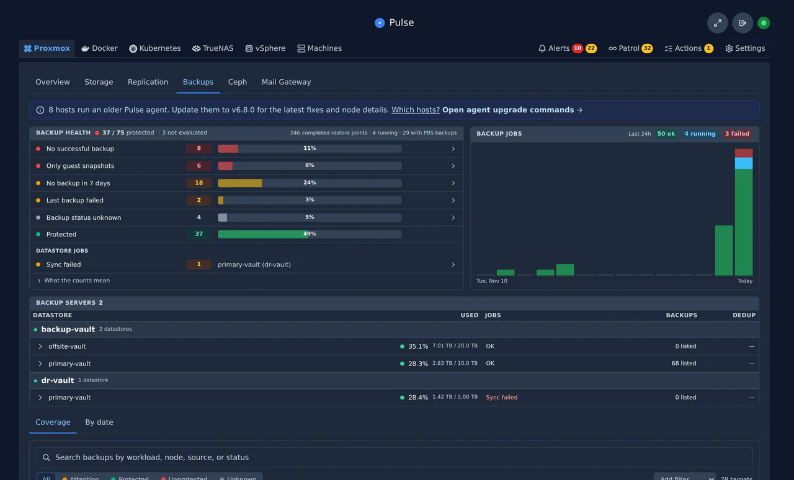
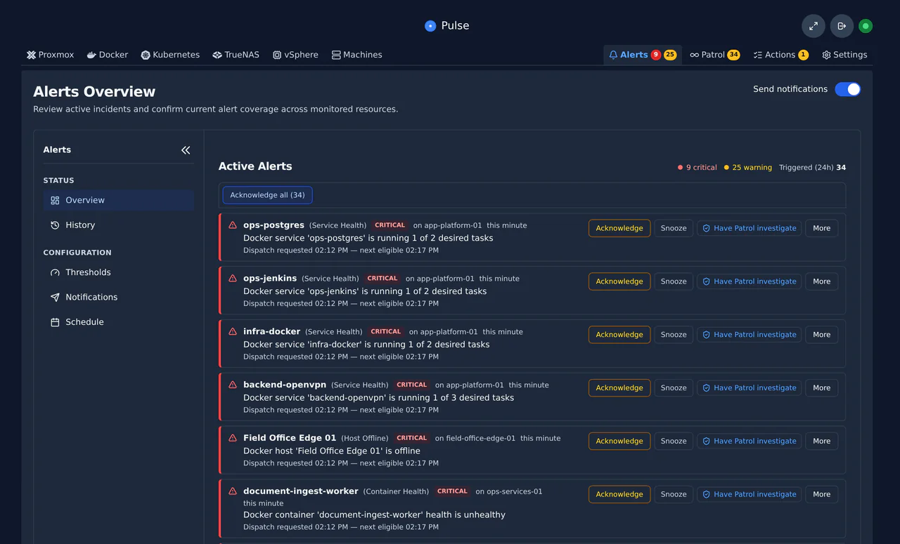
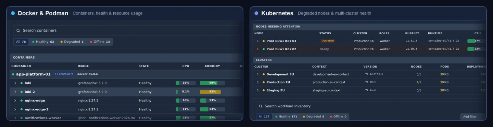
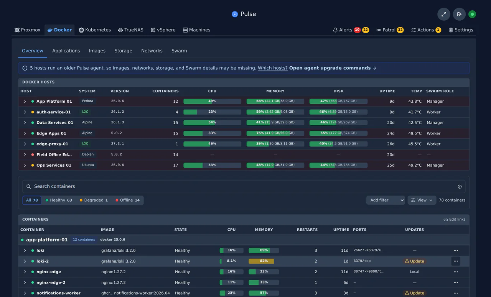
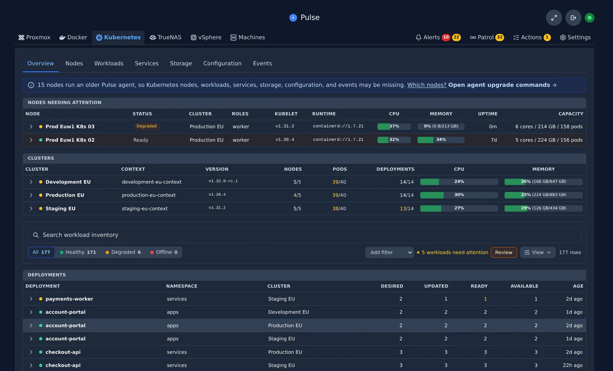
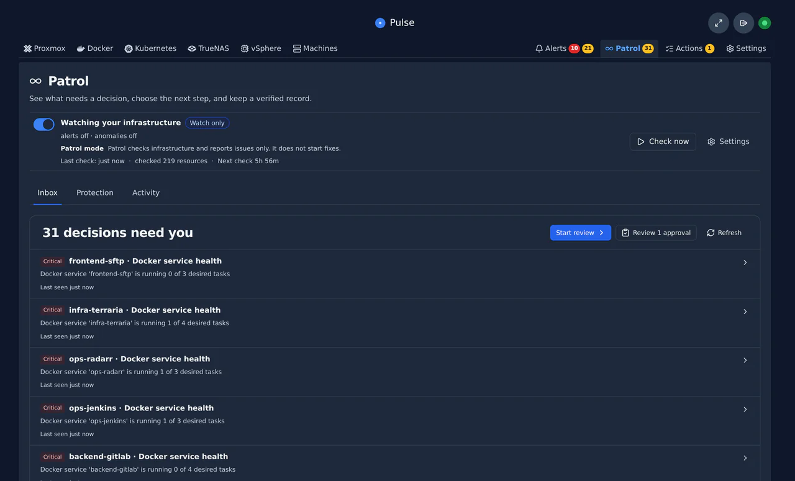

# Pulse

<div align="center">
  
  <p><strong>Real-time Proxmox, Docker and Kubernetes monitoring that finds what needs attention.</strong></p>

  [](https://github.com/rcourtman/Pulse)
  [](https://github.com/rcourtman/Pulse/releases/latest)
  [](https://hub.docker.com/r/rcourtman/pulse)
  [](LICENSE)

  [Live demo](https://demo.pulserelay.pro) · [Documentation](docs/README.md) · [Releases](https://github.com/rcourtman/Pulse/releases) · [Discussions](https://github.com/rcourtman/Pulse/discussions)
</div>

Pulse is a self-hosted monitoring and alerting dashboard for Proxmox, Docker,
Kubernetes, TrueNAS, vSphere, and Linux/Windows/macOS hosts. One lightweight
server tracks health, backups, availability checks, and metric history, and
alerts you when something needs attention.



<p align="center">
  Try the <a href="https://demo.pulserelay.pro">live demo</a> (Proxmox, <a href="https://demo.pulserelay.pro/docker/overview">Docker</a>, Kubernetes, Alerts). No sign-up required.
</p>

## Inside Pulse

### Built-in metric history
CPU, memory, disk, network I/O, and filesystem charts for every host, guest, and container without external databases.



### Backup coverage & PBS
Spot unprotected guests, stale backups, and failed sync jobs across Proxmox VE and Proxmox Backup Server.



### [Alerts](docs/ALERTING.md) & [Availability](docs/AVAILABILITY.md)
Thresholds plus Ping, TCP, UDP, HTTP(S), and TLS expiry checks via email, Discord, Slack, Telegram, ntfy, Gotify, Pushover, PagerDuty, or webhooks.



## Supported platforms



| Platform | What Pulse monitors |
|---|---|
| Proxmox VE, PBS & PMG | Nodes, VMs, LXCs, storage, backups, replication, Ceph, mail gateways |
| Docker & Podman | Hosts, containers, Compose projects, Swarm services, image updates |
| Kubernetes | Clusters, nodes, workloads, pods, services, storage, events |
| TrueNAS SCALE & CORE | Pools, datasets, disks, snapshots, replication, apps, VMs |
| Linux, Windows & macOS | Host health, filesystems, networking, temperatures, RAID, availability |
| VMware vSphere *(early access)* | Hosts, clusters, VMs, datastores, networks, snapshots |

<details>
<summary><strong>More full-screen views: Docker and Podman, Kubernetes, and Pulse Patrol</strong></summary>

### Docker & Podman
Hosts, containers, Compose stacks, Swarm health, and image updates without mounting the Docker socket on Pulse.



### Kubernetes
Multi-cluster health, degraded nodes, pods, deployments, storage, and events in one view.



### Optional AI & MCP
[Pulse Patrol](docs/AI.md) runs scheduled checks with your own AI provider or local model. The `pulse` CLI (`pulse auth login`, `pulse connect`) and [`pulse-mcp`](cmd/pulse-mcp/README.md#quick-start) let Claude Code, Codex, OpenCode, or Claude Desktop [ask what changed overnight](docs/WHAT_HAPPENED_OVERNIGHT.md).



</details>

## Install

Single container or Linux service on port `7655` (swap the tag if a [newer release](https://github.com/rcourtman/Pulse/releases/latest) is out).

### Docker

```bash
docker run -d \
  --name pulse \
  -p 7655:7655 \
  -v pulse_data:/data \
  -e PULSE_DEPLOYMENT_METHOD=docker_run \
  --restart unless-stopped \
  rcourtman/pulse:v6.8.0
```

<details>
<summary>Docker Compose</summary>

```yaml
services:
  pulse:
    image: rcourtman/pulse:v6.8.0
    container_name: pulse
    ports:
      - "7655:7655"
    volumes:
      - pulse_data:/data
    environment:
      - PULSE_DEPLOYMENT_METHOD=docker_compose
    restart: unless-stopped
volumes:
  pulse_data:
```

</details>

### Proxmox LXC or Linux

Signed installer: downloads, verifies against the pinned `pulse-installer` key, then runs:

```bash
export PULSE_VERSION=v6.8.0
curl -fsSLO "https://github.com/rcourtman/Pulse/releases/download/${PULSE_VERSION}/install.sh" &&
curl -fsSLO "https://github.com/rcourtman/Pulse/releases/download/${PULSE_VERSION}/install.sh.sshsig" &&
ssh-keygen -Y verify \
  -f <(printf '%s\n' 'pulse-installer namespaces="pulse-install" ssh-ed25519 AAAAC3NzaC1lZDI1NTE5AAAAIMZd/DaH+BldzOkq1A8KVTcFk73nAyrE8aJOyf7i00jm pulse-installer') \
  -I pulse-installer \
  -n pulse-install \
  -s install.sh.sshsig < install.sh &&
bash install.sh --version "${PULSE_VERSION}"
```

Also available: [Kubernetes with Helm](docs/KUBERNETES.md) · [Full install guide](docs/INSTALL.md).

### First run

Open `http://<your-ip>:7655` within 10 minutes of first boot to create your admin account directly, then add your first system under **Settings → Infrastructure**.

If the 10-minute first-boot window expires (or you set `PULSE_REQUIRE_BOOTSTRAP_TOKEN=true`), restart Pulse for a fresh window or unlock with `docker exec pulse /app/pulse bootstrap-token` (Docker) or `sudo pulse bootstrap-token` (Linux).

### Connect an AI agent or terminal CLI

Install the `pulse` client on your workstation using the [verified `install-cli.sh` / `install-cli.ps1` steps](docs/AGENT_SUBSTRATE.md#30-second-setup-with-the-pulse-cli) (or `brew install rcourtman/tap/pulse` once published to the Homebrew tap on release cut), then connect with a read-only `monitoring:read` token stored in your OS keychain:

```sh
pulse auth login https://your-pulse-host
pulse connect claude-code   # or: codex, opencode, claude-desktop
pulse doctor
pulse changes --since 12h
```

Then ask your agent *"What happened overnight?"* See the [agent integrations guide](docs/AGENT_SUBSTRATE.md) and [overnight walkthrough](docs/WHAT_HAPPENED_OVERNIGHT.md). Existing [`pulse-mcp`](cmd/pulse-mcp/README.md) setups continue to work.

### Do you need an agent?

**Often not.** Proxmox VE, PBS and PMG connect over their API with a read-only token, so no Pulse host agent is required. Install the unified agent (including v5-to-v6 agent upgrades) from **Settings → Infrastructure → Install on a host** for Docker/Podman, Kubernetes, standalone machines, or SMART/temperature sensors. Command execution stays off by default ([agent security model](docs/AGENT_SECURITY.md)).

> [!NOTE]
> Proxmox VM disk/memory queries use QEMU Guest Agent, which shares the channel used by freeze-enabled backups. Read the [backup safety precaution](docs/VM_DISK_MONITORING.md#backup-safety) before changing guest-agent settings during backups.

## Editions

- **Community (free, MIT):** full self-hosted monitoring (not gated by system or resource count), core SSO, update alerts, and Patrol with your own AI provider or local model.
- **Pro:** Community plus Patrol investigation/fixes, centralized agent profiles, RBAC, audit logging, and reporting ([capability reference](docs/PULSE_PRO.md) · [plans](https://pulserelay.pro)).
- **MSP:** isolated per-client workspaces under one Pulse Account, with a 60-day free trial for two clients at [Pulse for MSPs](https://pulserelay.pro/msp).

> [!IMPORTANT]
> GitHub releases and `rcourtman/pulse` are Community builds. Pro and legacy customers download from the [Pulse download portal](https://pulserelay.pro/download.html). Relay is no longer sold: existing subscribers keep Pro features at their current price, and paired phones keep working until **31 March 2027** ([details](docs/PULSE_PRO.md)).

## Documentation

- **Docs:** [Install](docs/INSTALL.md) · [Upgrading from v5](docs/UPGRADE_v6.md) · [Configuration](docs/CONFIGURATION.md) · [Production security](docs/PRODUCTION_SECURITY.md) · [API](docs/API.md) · [Troubleshooting](docs/TROUBLESHOOTING.md) · [Architecture](ARCHITECTURE.md) · [Security](SECURITY.md) · [Privacy](docs/PRIVACY.md) · [Code signing](docs/CODE_SIGNING_POLICY.md)
- **Other languages:** [Deutsch](docs/i18n/de/README.md) · [Español](docs/i18n/es/README.md) · [Français](docs/i18n/fr/README.md)

## Community and support

- [GitHub Discussions](https://github.com/rcourtman/Pulse/discussions) · [GitHub Issues](https://github.com/rcourtman/Pulse/issues) (read the [safe reporting guidance](docs/TROUBLESHOOTING.md#-getting-help) first and keep credentials out of public attachments) · [Home Assistant add-ons](https://github.com/Kosztyk/homeassistant-addons) · [GitHub Sponsors](https://github.com/sponsors/rcourtman) · [Ko-fi](https://ko-fi.com/rcourtman)

## Development & license

Go 1.26 + SolidJS/TypeScript (`npm ci && npm --prefix frontend-modern ci && npm run dev`, proxies `:5173` → `:7655`). See [CONTRIBUTING.md](CONTRIBUTING.md) before opening changes (Pulse works issue-first).

Everything in this repository is [MIT licensed](LICENSE), with no dual licensing and no source-available code. Pulse Pro is a separate commercial product at [pulserelay.pro](https://pulserelay.pro) ([Terms of Service](TERMS.md)).
