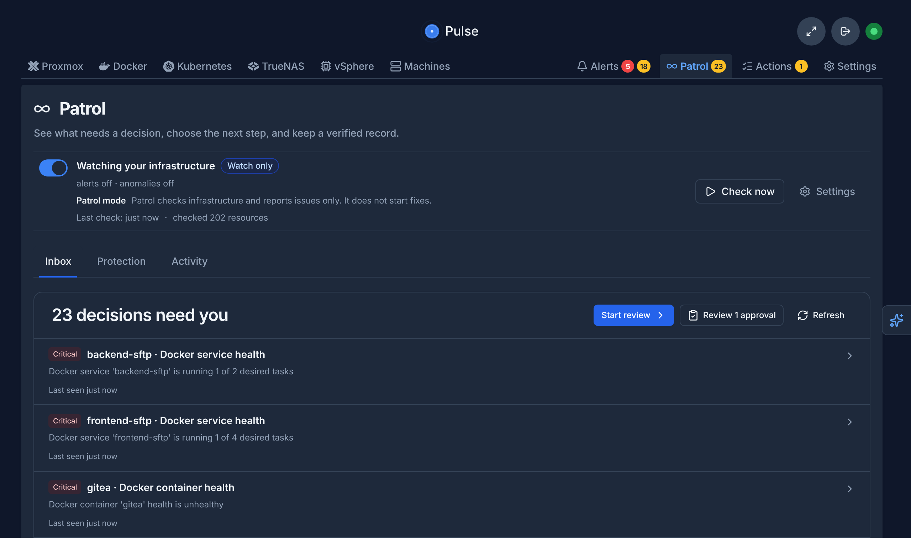

# Pulse screenshots

These captures use the same generated mock environment as the public
read-only demo and show the current platform-shaped Pulse interface. Explore
it at [demo.pulserelay.pro](https://demo.pulserelay.pro); the demo signs you in
automatically.

## Proxmox workspace

The Proxmox page keeps node health, guests, storage, backup freshness, Ceph,
replication, and mail-gateway context together. Docker, Kubernetes, TrueNAS,
vSphere, and Machines use the same platform-page pattern.

## Patrol attention queue

Patrol turns cross-platform checks into an inbox of decisions, with protection
coverage and an activity record beside it. Watch-only mode reports findings
without starting changes; higher-autonomy modes remain
subject to the configured plan, policy, approval, and verification boundaries.

Screenshots use generated demo data. Names, metrics, alerts, and infrastructure
state shown here do not represent a real deployment.
